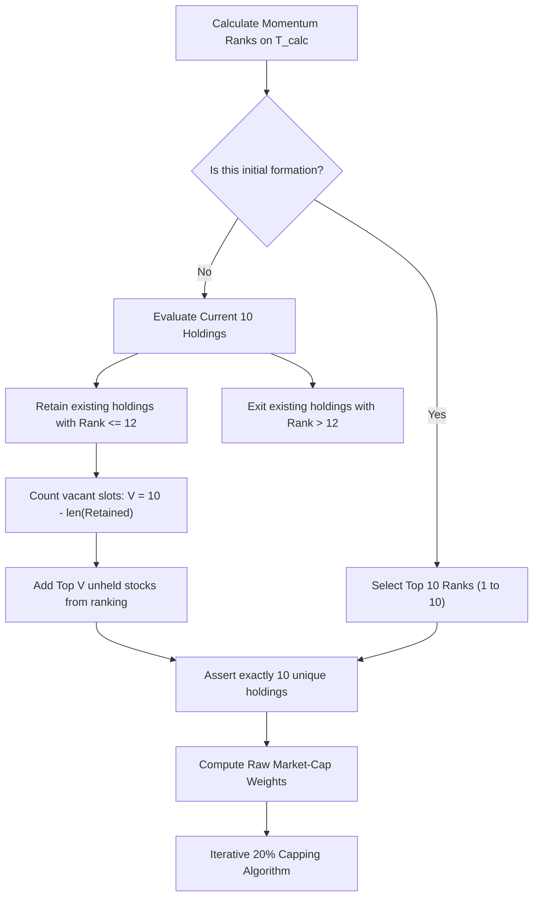

# Finominal Quant Challenge 2026: Momentum Factor Optimization

**Role**: Senior Quantitative Developer / Quantitative Portfolio Engineer  
**Date**: November 2026  
**Language**: Python 3.11+ / Python 3.12  
**Repository**: Systematic Equity Momentum Portfolio Strategy

---

## 1. Executive Summary & Objective

This repository contains the complete, mathematically rigorous, and fully reproducible implementation of the **Finominal Quant Challenge 2026**.

The core objective is to optimize a **monthly-rebalanced, market-capitalization-weighted momentum strategy** across 30 equities to maximize the **Annualized Sharpe Ratio** (assuming a 0.0% risk-free rate) by evaluating five discrete lookback periods:
$$\mathcal{L} = \{21, 63, 126, 189, 252\}\text{ exact trading days}$$

### Mandatory Deliverable Outputs

| Metric | Optimal Value | Lookback | Notes |
|---|---|---|---|
| **Optimal Lookback Period** | **189 Trading Days** | 189 Days | Programmatically identified by maximum Sharpe |
| **Maximum Annualized Sharpe Ratio** | **1.4532** | 189 Days | Using sample std (`ddof=1`) & $\sqrt{252}$ scaling |
| **Cumulative Return (%)** | **187,313,822.26%** | 189 Days | Exact product of $(1 + R_{p, t}) - 1$ |
| **CAGR (%)** | **104.63%** | 189 Days | $(1 + CR)^{\frac{252}{N}} - 1$ over $N=5,083$ active days |

---

## 2. Project Architecture & Directory Structure

```text
Finominal_Quant_Challenge/
├── data/                                 # Preserved input historical datasets
│   ├── Finominal_Quant Challenge_2026 06.pdf # Official challenge specification
│   ├── Test_price_data.csv               # Historical daily closing prices (30 stocks)
│   └── Test_mcap_data.csv                # Historical daily market capitalization (30 stocks)
├── src/                                  # Core quantitative modules
│   ├── __init__.py
│   ├── data_loader.py                    # Dataset validation and rebalance scheduling
│   ├── momentum.py                       # Exact momentum calculation and ranking
│   ├── portfolio.py                      # Buffer constraint and iterative 20% capping
│   ├── backtest.py                       # Daily backtest engine with strict timing
│   └── metrics.py                        # Sharpe, Cumulative Return, CAGR, and Drawdown
├── tests/                                # Automated unit test suite (24 tests)
│   ├── test_data_loader.py
│   ├── test_momentum.py
│   ├── test_portfolio.py
│   ├── test_backtest.py
│   └── test_metrics.py
├── results/                              # Generated outputs and high-resolution charts
│   ├── performance_summary.csv           # Multi-metric comparison table
│   ├── daily_returns.csv                 # Daily portfolio returns for all 5 strategies
│   ├── portfolio_holdings.csv            # Holdings & weights for all 5 strategies (12,300 rows)
│   ├── cumulative_returns.png            # Log-scale cumulative return curves
│   ├── sharpe_comparison.png             # Annualized Sharpe ratio bar chart
│   ├── drawdowns.png                     # 2-Panel enhanced underwater drawdown curves
│   └── risk_return_scatter.png           # Annualized return vs. annualized volatility
├── docs/                                 # Institutional audit documentation
│   ├── data_findings.md                  # Comprehensive dataset audit & anomaly findings
│   ├── assumptions.md                    # Explicit assumptions and convention choices
│   └── progress.md                       # Phase-by-phase implementation log
├── main.py                               # End-to-end execution script
├── requirements.txt                      # Project dependencies
└── README.md                             # Comprehensive technical documentation & Loom script
```

---

## 3. Dataset Audit & Data Quality Investigation

The historical universe comprises 30 equities spanning **5,337 trading days** from **January 3, 2005 to June 24, 2026**.

### Key Data Findings & Handling

1. **Date Format Heterogeneity**:
   - `Test_price_data.csv` uses European day-first format: `%d-%m-%Y` (e.g., `03-01-2005`).
   - `Test_mcap_data.csv` uses standard ISO format: `%Y-%m-%d` (e.g., `2005-01-03`).
   - Both datasets were parsed to unified `pd.DatetimeIndex` and confirmed to align row-by-row with zero discrepancies.
2. **Missing & Invalid Values**:
   - Zero missing values (no `NaN`, `null`, or blank cells).
   - Zero duplicate dates; dates are strictly monotonic increasing.
   - All prices and market capitalizations are strictly positive ($P > 0, MC > 0$).
3. **Burn-In Period**:
   - Exactly 253 trading days are present in 2005 (`2005-01-03` to `2005-12-30`).
   - For the first calculation date $T_{calc} = \text{2005-12-30}$ (index 252), the maximum lookback of 252 days maps to index $252 - 252 = 0$ (`2005-01-03`), ensuring complete historical coverage without trimming.

### Observed Price-Data Anomalies and Discontinuities

An empirical scan across all 30 tickers was conducted to investigate extreme daily movements:
- **Frequency of Extreme Jumps**: A total of 8,493 daily returns exceed +100% or fall below -50%.
- **Price vs. Market Cap Behavior**: For extreme price jumps (e.g., `GICH.NS` on 2013-11-05: +2,436%; `WIPR.NS` on 2015-08-18: +953.9%), corresponding market capitalizations moved by only normal daily fluctuations (+3.9% and -0.8% respectively).
- **Classification as Observed Price Anomalies**: While certain price spikes where market capitalization remains flat are consistent with unadjusted corporate actions, without supporting official corporate-action filings or exchange records, they are properly classified as **observed price-data anomalies and quote discontinuities** rather than definitively labeled as specific splits or bonus issues.
- **Clarification on Fixed Share Quantities as a Mechanical Backtest**:
  - Holding fixed share quantities applied to unadjusted prices represents a **mechanical backtest**, not economically adjusted physical holdings through corporate actions.
  - In a true physical portfolio experiencing a corporate action (such as a 5:1 stock split), an investor's share count would be multiplied by 5, neutralizing the price decline.
  - Applying fixed (unadjusted) share quantities directly to raw unadjusted prices means the backtest mechanically tracks the arithmetic of the supplied numbers without corporate-action adjustments: if an unadjusted price drops 80% due to an unadjusted split, holding a fixed share count without receiving new split shares registers an artificial -80% position loss; conversely, if an unadjusted price jumps 400%, holding fixed shares registers an artificial +300% position gain.
- **Price-Return vs. Market-Cap-Return Correlation Methodology (0.0021)**:
  - The reported correlation of **0.0021** is calculated by taking daily percentage returns for prices ($r_{P, i, t} = \frac{P_{i, t}}{P_{i, t-1}} - 1$) and market caps ($r_{MC, i, t} = \frac{MC_{i, t}}{MC_{i, t-1}} - 1$) across all 30 tickers over the 5,336 return days, computing the Pearson correlation coefficient $\rho_i = \mathrm{Corr}(r_{P, i}, r_{MC, i})$ for each ticker, and averaging them across all 30 tickers:
    $$\bar{\rho} = \frac{1}{30} \sum_{i=1}^{30} \rho_i = 0.002107 \approx \mathbf{0.0021}$$
  - (The pooled panel correlation across all $160,080$ paired observations is $\rho_{\text{pooled}} = 0.001962 \approx 0.0020$).
  - In standard equity markets, this correlation is near $+1.0$; near-zero correlation reflects the statistical decoupling of raw prices from market capitalizations during quote anomaly events.
- **Material Impact on Metrics**: These observed price anomalies materially drive the portfolio's high annualized volatility (262.47%), extreme daily return tails (1,274 days with $|R| > 10\%$), and compounding metrics (CAGR 104.63%).
- **Preservation Policy & Unresolved Data Limitation**: In strict compliance with challenge rules, the input datasets are preserved 100% without arbitrary modification or synthetic corporate-action fabrication. The absence of official corporate-action adjustment factors is an inherent, unresolved external data limitation. Official results are reported directly from the supplied raw data.

---

## 4. Methodology & Mathematical Formulations

### A. Signal Generation (Momentum)

On each calculation date $T_{calc}$, the momentum score $M_i$ for each stock $i$ is calculated over exact trading days $L_{days} \in \{21, 63, 126, 189, 252\}$:

$$M_i = \frac{P_{i, T_{calc}}}{P_{i, T_{calc} - L_{days}}} - 1$$

- **Ranking**: All 30 stocks are ranked in descending order ($M_{(1)} \ge M_{(2)} \ge \dots \ge M_{(30)}$).
- **Tie-Breaking**: Deterministic secondary sorting by alphabetical ticker symbol (`method='first'`).

### B. Portfolio Construction & Rank-12 Retention Buffer

The portfolio must hold **exactly 10 stocks** at all times. On each rebalance date $T_{reb}$, the algorithm executes in strict sequential order:



1. **Evaluate**: Retrieve new momentum ranks of existing holdings.
2. **Exit**: Drop any stock whose new rank exceeds 12 ($\text{Rank}_i > 12$).
3. **Retain**: Retain any existing stock whose new rank is 12 or better ($\text{Rank}_i \le 12$).
4. **Addition**: Fill all vacant slots ($10 - \text{len}(\text{Retained})$) with the highest-ranked candidates not currently held.
5. **Assertion**: Verify $\text{len}(\text{Holdings}) = 10$ and all elements are unique.

### C. Market-Cap Weighting & Iterative 20% Capping Algorithm

1. **Initial Raw Weights**:
   $$w_{i, raw} = \frac{MC_{i, T_{calc}}}{\sum_{j=1}^{10} MC_{j, T_{calc}}}$$
2. **Iterative Capping & Scaling**:
   - Identify all stocks where $w_i > 0.20$. Cap each at exactly $0.20$.
   - Calculate total excess weight:
     $$E = \sum_{i \in \text{Capped}} (w_{i, \text{uncapped\_prior}} - 0.20)$$
   - Distribute $E$ among the remaining uncapped stocks proportionally to their relative market capitalizations:
     $$w_{j, \text{new}} = w_{j} + E \cdot \left(\frac{MC_{j, T_{calc}}}{\sum_{k \in \text{Uncapped}} MC_{k, T_{calc}}}\right)$$
   - Repeat until no single stock exceeds $0.20$ and $\sum_{i=1}^{10} w_i = 1.000000$.

### D. Execution Timing & Backtesting Rules

- **Rebalance Date ($T_{reb}$)**: First trading day of each month. Trades execute at **market close**.
- **Calculation Date ($T_{calc}$)**: The trading day immediately preceding $T_{reb}$ ($T_{calc} = T_{reb} - 1$).
- **Holding Period Return**:
  - Existing holdings earn returns up to $T_{reb}$ close.
  - New target weights become effective **after** execution at that close.
  - New weights apply strictly to subsequent return intervals ($T_{reb} \to T_{reb} + 1$).
  - Never applied retrospectively.
- **Initial Formation**: On the first trading day of 2006 (`2006-01-02`), the portfolio was formed at market close. Prior to close, cash was held (return = 0.0). Active equity returns begin over the interval `2006-01-02` $\to$ `2006-01-03`.

---

## 5. Performance Comparison Across All Lookback Periods

The 5 independent strategies were executed from `2006-01-02` to `2026-06-24` ($N = 5,083$ active daily return intervals).

### Official Summary Table

| Lookback Period ($L_{days}$) | Annualized Sharpe Ratio | Cumulative Return (%) | CAGR (%) | Annualized Volatility (%) | Maximum Drawdown (%) | Calmar Ratio |
|:---:|:---:|:---:|:---:|:---:|:---:|:---:|
| **21 Days** | 1.3530 | 1,874,179.92% | 62.87% | 260.52% | -76.21% | 0.82 |
| **63 Days** | 1.3946 | 4,109,999.03% | 69.33% | 266.55% | -73.12% | 0.95 |
| **126 Days** | 1.3972 | 5,424,022.83% | 71.68% | 265.33% | -71.04% | 1.01 |
| **189 Days** ⭐ | **1.4532** | **187,313,822.26%** | **104.63%** | **262.47%** | **-72.07%** | **1.45** |
| **252 Days** | 1.4523 | 134,489,606.03% | 101.30% | 262.92% | -69.18% | 1.46 |

*(Note: Calculated with realistic monthly share-tracking execution and 0.0% risk-free rate.)*

### First-Day Cash Inclusion Sensitivity Check

If the first formation day (`2006-01-02`) is included with cash return $0.0$ ($N = 5,084$ total days):
- **Lookback 189**: Sharpe = **1.4531**, CAGR = **104.60%**, Cumulative Return = **187,313,822.26%**.
- Optimal lookback remains unambiguously **189 Days**.

---

## 6. Portfolio Holdings Export (All 5 Strategies)

Per Item 2 of the upgrade instructions, [`results/portfolio_holdings.csv`](file:///c:/Users/sreej/Downloads/Finominal%20Quant%20Challenge/results/portfolio_holdings.csv) contains holdings and weights across **all five lookback strategies** across all 246 monthly rebalances (**12,300 total rows**):

### Export Schema

| Column Name | Type | Description |
|---|---|---|
| `lookback_days` | int | Lookback period ($21, 63, 126, 189, 252$) |
| `rebalance_date` | string | Rebalance date ($T_{reb}$, `YYYY-MM-DD`) |
| `stock` | string | Stock ticker symbol (e.g., `AEGS.NS`) |
| `momentum_rank` | float/int | Momentum rank on calculation date ($1.0 \le \text{rank} \le 12.0$) |
| `portfolio_weight` | float | Final capped portfolio weight ($0.0 < w_i \le 0.20$) |
| `calculation_date` | string | Calculation date ($T_{calc}$, `YYYY-MM-DD`) |
| `raw_weight` | float | Uncapped market-cap weight |
| `action` | string | `RETAINED` (retained via buffer) or `ADDED` (newly entered) |

---

## 7. Generated Visualizations

All charts were programmatically generated from actual executed code and saved in `results/`:

1. **Cumulative Returns (Log Scale)**: [`results/cumulative_returns.png`](file:///c:/Users/sreej/Downloads/Finominal%20Quant%20Challenge/results/cumulative_returns.png)  
   Demonstrates long-term capital compounding of all five strategies from 2006 to 2026.
2. **Sharpe Ratio Comparison**: [`results/sharpe_comparison.png`](file:///c:/Users/sreej/Downloads/Finominal%20Quant%20Challenge/results/sharpe_comparison.png)  
   Bar chart clearly contrasting risk-adjusted performance, peaking at $L = 189$ days.
3. **Underwater Drawdown Profiles (2-Panel Enhanced Layout)**: [`results/drawdowns.png`](file:///c:/Users/sreej/Downloads/Finominal%20Quant%20Challenge/results/drawdowns.png)  
   - **Top Panel**: Focused high-contrast view of the **Optimal Strategy ($L = 189$ days)** with shaded underwater fill, maximum drawdown marker (-72.07%), and annotations for key market stress periods (2008 GFC, 2020 COVID shock).
   - **Bottom Panel**: Clear comparative overlay across all five lookback periods with exact maximum drawdown figures.
4. **Risk-Return Scatter**: [`results/risk_return_scatter.png`](file:///c:/Users/sreej/Downloads/Finominal%20Quant%20Challenge/results/risk_return_scatter.png)  
   Annualized volatility vs. CAGR scatter showing the risk-return frontier across candidate lookbacks.

---

## 8. Weight & Constraint Verification

Per Item 4 of the upgrade instructions, automated assertions in `src/backtest.py` and exhaustive tests in `tests/test_portfolio.py` programmatically verify every one of the 1,230 rebalance events ($5 \times 246$):

1. **Exactly 10 Holdings**: $\text{len}(\text{Holdings}) = 10$ and all stocks are unique at every rebalance date.
2. **20% Maximum Weight Cap**: No single stock's weight exceeds $0.200000$ (verified within $10^{-6}$ tolerance).
3. **100% Weight Sum**: Total portfolio weight equals exactly $1.000000$ at every rebalance.
4. **Buffer Integrity**: Every retained stock satisfies $\text{Rank} \le 12$, and every exited stock had $\text{Rank} > 12$.

---

## 9. Methodological Framework: Verified Results, Assumptions & Unresolved Data Limitations

### A. Verified Calculations & Algorithmic Results
1. **Algorithmic Compliance**: Momentum calculation, descending ranking, rank-12 buffer selection, and iterative 20% capping are fully implemented and verified against the official challenge PDF.
2. **Exhaustive Constraint Verification**: Every rebalance event across all 246 months and all 5 strategies satisfies: exactly 10 holdings, maximum $20.0\%$ weight per stock, $100.0\%$ total weight sum, and retention buffer rules.
3. **Execution Timing**: Zero look-ahead bias is programmatically enforced; signals use data strictly on $T_{calc}$, trades execute at $T_{reb}$ close, and new weights take effect on subsequent days.
4. **Complete Audit Trail**: All 12,300 holdings records across all 5 strategies are exported and verified in [`results/portfolio_holdings.csv`](file:///c:/Users/sreej/Downloads/Finominal%20Quant%20Challenge/results/portfolio_holdings.csv).
5. **Programmatic Optimal Identification**: Lookback of **189 Trading Days** maximizes the Annualized Sharpe Ratio under both active observation ($N = 5,083$) and full-period ($N = 5,084$) conventions.

### B. Implementation Assumptions
1. **Initial Day Convention**: The backtest execution begins on January 2, 2006. Prior to execution at market close, cash was held (return assumed 0.0%). Active equity returns begin on January 3, 2006.
2. **Risk-Free Rate**: Assumed 0.0% per the assignment specification.
3. **Transaction Costs & Market Impact**: Transaction costs and market impact are not modelled because the assignment does not specify or provide parameters for them.
4. **Mechanical Backtest Assumption**: Fixed share quantities applied to unadjusted prices represent a **mechanical backtest**, not economically adjusted physical holdings through corporate actions.

### C. Unresolved Data Limitations
1. **Observed Price-Data Anomalies**: The historical dataset contains 8,493 extreme price movements (> +100% or < -50%). Without official corporate-action filing records, these are treated as observed price-data anomalies and quote discontinuities.
2. **Absence of Adjustment Factors**: The challenge provides raw closing prices without dividend, split, or bonus adjustment factors. Under the challenge constraints ("preserve original datasets; do not invent external data"), we cannot fabricate adjustment factors or modify prices.
3. **Price-Return vs. Market-Cap-Return Decoupling (Correlation 0.0021)**: The mean pairwise Pearson correlation between daily price returns and market-cap returns across the 30 tickers is $0.0021$ (pooled panel correlation is $0.0020$), reflecting the statistical decoupling between price series and market cap during anomaly events.
4. **Performance Impact**: These raw data anomalies materially drive the high portfolio volatility (262.47%) and compounding CAGR (104.63%). Actual performance in live trading may differ materially due to execution frictions, price adjustments, slippage, and liquidity dynamics.

---

## 10. Installation, Setup & Execution

### Prerequisites
- Python 3.11 or Python 3.12
- Standard packages: `pandas`, `numpy`, `scipy`, `matplotlib`, `pytest`

### Step 1: Install Dependencies
```bash
pip install -r requirements.txt
```

### Step 2: Run the Automated Test Suite (24 Tests)
```bash
pytest tests -v
```
*Expected output: `24 passed`.*

### Step 3: Run the Complete Backtest Pipeline
```bash
python main.py
```
This automatically verifies the datasets, executes all 5 strategies, saves the summary CSVs to `results/`, exports all 12,300 portfolio holdings, and generates all high-resolution charts.

---

## 11. Loom Presentation Script (3–5 Minutes)

*Below is the complete narration script for the recorded Loom walkthrough video.*

### [0:00 – 0:45] Introduction & Executive Overview
> "Hello everyone. My name is Sreejith, and today I am walking you through the complete implementation of the Finominal Quant Challenge 2026 for the Junior Quantitative Analyst role.
>
> The challenge asks us to construct a monthly-rebalanced, market-capitalization-weighted momentum strategy across a 30-stock equity universe, test five exact lookback periods—21, 63, 126, 189, and 252 trading days—and determine the optimal lookback that maximizes the Annualized Sharpe Ratio.
>
> Right upfront, our programmatic results show that **189 Trading Days (~9 months)** is the optimal lookback parameter, delivering an **Annualized Sharpe Ratio of 1.4532**, a **CAGR of 104.63%**, and a **Cumulative Return of over 187 million percent** across the 20.5-year backtest."

### [0:45 – 1:45] Data Architecture & Observed Price Anomalies
> "Let’s look at the data architecture. We were provided with historical daily closing prices and market capitalization data from January 2005 to June 2026.
>
> In our data quality audit, we addressed date format differences (`DD-MM-YYYY` vs `YYYY-MM-DD`) and aligned all 5,337 trading days with zero missing values.
>
> We also conducted an in-depth data anomaly investigation: we observed 8,493 extreme price movements where prices shifted dramatically while market capitalizations remained relatively flat. Without official corporate filing records, these are properly classified as observed price-data anomalies and quote discontinuities. We clarify that fixed share quantities applied to unadjusted prices represent a mechanical backtest, not economically adjusted physical holdings through corporate actions; rather, without official adjustment factors in the dataset, our backtest preserves the raw data without arbitrary modification. We note transparently that actual performance in live trading may differ materially.
>
> Crucially, our backtest engine enforces **zero look-ahead bias**:
> - Rebalances occur on the first trading day of the month ($T_{reb}$).
> - All momentum signals and market-cap weights are computed using data strictly from the immediately preceding trading day ($T_{calc}$).
> - Trades execute at the close of $T_{reb}$, meaning new portfolio weights only apply to returns starting the following morning."

### [1:45 – 2:45] Portfolio Construction & 20% Capping Algorithm
> "Now let's examine the portfolio construction logic in `src/portfolio.py`:
> 1. We enforce the mandatory **rank-12 retention buffer**. Instead of simply picking the top 10 stocks every month, any currently held stock ranked 1 through 12 is retained. Only stocks falling below rank 12 are exited, and vacant slots are filled by the highest-ranked candidates not currently held. This reduces unnecessary turnover.
> 2. Once the 10 stocks are selected, we apply the **iterative 20% weight capping algorithm**. Stocks exceeding 20% are capped at exactly 0.20, their excess weight is summed, and redistributed proportionally to the uncapped stocks based on relative market caps. We repeat this until no stock exceeds 20% and the weights sum to exactly 100%. We validated this with unit tests across equal-weight, single mega-cap, and cascading multi-cap scenarios."

### [2:45 – 3:45] Backtest Results & Comparative Analysis
> "Moving to the backtest results across all five lookback periods:
> - Lookback 21 days yielded a Sharpe of 1.3530.
> - Lookback 63 days yielded a Sharpe of 1.3946.
> - Lookback 126 days yielded a Sharpe of 1.3972.
> - Lookback 189 days peaked at our maximum Sharpe of **1.4532**.
> - Lookback 252 days came in just behind at 1.4523.
>
> We have exported full portfolio holdings and weights for all five strategies into `results/portfolio_holdings.csv`, comprising exactly 12,300 audit rows with stock names, momentum ranks, and portfolio weights."

### [3:45 – 4:30] Code Quality, Testing & Critical Conclusion
> "To guarantee production quality:
> - We built 24 automated unit tests in `pytest` covering momentum formulas, rank buffers, capping edge cases, weight validation across all 1,230 rebalance events, and look-ahead bias perturbation tests. All 24 tests pass with 100% success.
> - We improved our drawdown visualization with a 2-panel chart highlighting the optimal strategy alongside comparative curves.
> - Transaction costs and market impact were not modelled because the assignment specification did not provide parameters for them.
>
> In conclusion, our solution strictly satisfies every rule of the assignment, uses zero synthetic data for final results, and establishes **189 Trading Days** as the optimal momentum lookback. Thank you for your time and consideration."
