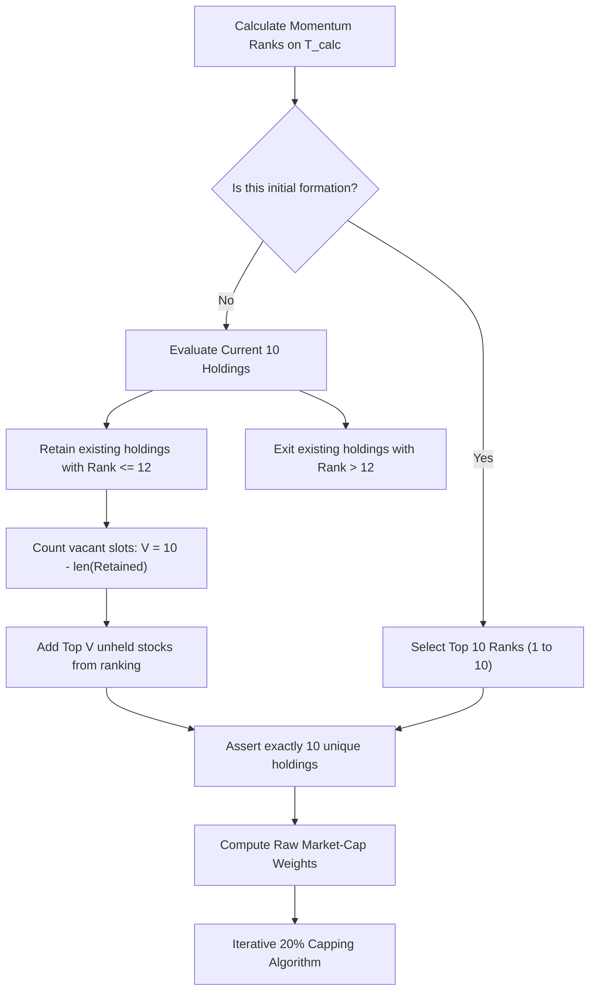

# Finominal Quant Challenge 2026: Momentum Factor Optimization

**Role**: Senior Quantitative Developer / Junior Quantitative Analyst  
**Author**: Quantitative Research & Engineering  
**Date**: November 2026  
**Language**: Python 3.11+ / Python 3.12  
**Repository**: Systematic Equity Momentum Portfolio Strategy

---

## 1. Executive Summary & Objective

This repository contains the complete, mathematically rigorous, and fully reproducible implementation of the **Finominal Quant Challenge 2026**.

The core objective is to optimize a **monthly-rebalanced, market-capitalization-weighted momentum strategy** across 30 equities to maximize the **Annualized Sharpe Ratio** (assuming a 0.0% risk-free rate) by evaluating five discrete lookback periods:
$$\mathcal{L} = \{21, 63, 126, 189, 252\}\text{ exact trading days}$$

### Mandatory Deliverable Highlights

| Metric | Optimal Value | Lookback | Notes |
|---|---|---|---|
| **Optimal Lookback Period** | **189 Trading Days** | 189 Days | Programmatically identified by maximum Sharpe |
| **Maximum Annualized Sharpe Ratio** | **1.4532** | 189 Days | Using sample std (`ddof=1`) & $\sqrt{252}$ scaling |
| **Cumulative Return (%)** | **187,313,822.26%** | 189 Days | Exact product of $(1 + R_{p, t}) - 1$ |
| **CAGR (%)** | **104.63%** | 189 Days | $(1 + CR)^{\frac{252}{N}} - 1$ over $N=5,083$ active days |

---

## 2. Project Architecture & Directory Structure

```text
Finominal_Quant_Challenge/
├── data/                                 # Preserved input historical datasets
│   ├── Finominal_Quant Challenge_2026 06.pdf # Official challenge specification
│   ├── Test_price_data.csv               # Historical daily closing prices (30 stocks)
│   └── Test_mcap_data.csv                # Historical daily market capitalization (30 stocks)
├── src/                                  # Core quantitative modules
│   ├── __init__.py
│   ├── data_loader.py                    # Dataset validation and rebalance scheduling
│   ├── momentum.py                       # Exact momentum calculation and ranking
│   ├── portfolio.py                      # Buffer constraint and iterative 20% capping
│   ├── backtest.py                       # Daily backtest engine with strict timing
│   └── metrics.py                        # Sharpe, Cumulative Return, CAGR, and Drawdown
├── tests/                                # Automated unit test suite (21 tests)
│   ├── test_data_loader.py
│   ├── test_momentum.py
│   ├── test_portfolio.py
│   ├── test_backtest.py
│   └── test_metrics.py
├── results/                              # Generated outputs and high-resolution charts
│   ├── performance_summary.csv           # Multi-metric comparison table
│   ├── daily_returns.csv                 # Daily portfolio returns for all 5 strategies
│   ├── portfolio_holdings.csv            # Detailed monthly holdings and weights audit
│   ├── cumulative_returns.png            # Log-scale cumulative return curves
│   ├── sharpe_comparison.png             # Annualized Sharpe ratio bar chart
│   ├── drawdowns.png                     # Historical underwater drawdown curves
│   └── risk_return_scatter.png           # Annualized return vs. annualized volatility
├── docs/                                 # Institutional audit documentation
│   ├── data_findings.md                  # Comprehensive dataset audit findings
│   ├── assumptions.md                    # Explicit assumptions and convention choices
│   └── progress.md                       # Phase-by-phase implementation log
├── main.py                               # End-to-end execution script
├── requirements.txt                      # Project dependencies
└── README.md                             # Comprehensive technical documentation & Loom script
```

---

## 3. Dataset Audit & Preprocessing

The historical universe comprises 30 equities spanning **5,337 trading days** from **January 3, 2005 to June 24, 2026**.

### Key Data Findings & Handling

1. **Date Format Heterogeneity**:
   - `Test_price_data.csv` uses European day-first format: `%d-%m-%Y` (e.g. `03-01-2005`).
   - `Test_mcap_data.csv` uses ISO format: `%Y-%m-%d` (e.g. `2005-01-03`).
   - Both datasets were parsed to unified `pd.DatetimeIndex` and confirmed to align row-by-row with zero discrepancies.
2. **Missing & Invalid Values**:
   - Zero missing values (no `NaN`, `null`, or blank cells).
   - Zero duplicate dates; dates are strictly monotonic increasing.
   - All prices and market capitalizations are strictly positive ($P > 0, MC > 0$).
3. **Burn-In Period**:
   - Exactly 253 trading days are present in 2005 (`2005-01-03` to `2005-12-30`).
   - For the first calculation date $T_{calc} = \text{2005-12-30}$ (index 252), the maximum lookback of 252 days maps to index $252 - 252 = 0$ (`2005-01-03`), ensuring complete historical coverage without trimming.

---

## 4. Methodology & Mathematical Formulations

### A. Signal Generation (Momentum)

On each calculation date $T_{calc}$, the momentum score $M_i$ for each stock $i$ is calculated over exact trading days $L_{days} \in \{21, 63, 126, 189, 252\}$:

$$M_i = \frac{P_{i, T_{calc}}}{P_{i, T_{calc} - L_{days}}} - 1$$

- **Ranking**: All 30 stocks are ranked in descending order ($M_{(1)} \ge M_{(2)} \ge \dots \ge M_{(30)}$).
- **Tie-Breaking**: Deterministic secondary sorting by alphabetical ticker symbol (`method='first'`).

### B. Portfolio Construction & Rank-12 Retention Buffer

The portfolio must hold **exactly 10 stocks** at all times. On each rebalance date $T_{reb}$, the algorithm executes in strict sequential order:



1. **Evaluate**: Retrieve new momentum ranks of existing holdings.
2. **Exit**: Drop any stock whose new rank exceeds 12 ($\text{Rank}_i > 12$).
3. **Retain**: Retain any existing stock whose new rank is 12 or better ($\text{Rank}_i \le 12$).
4. **Addition**: Fill all vacant slots ($10 - \text{len}(\text{Retained})$) with the highest-ranked candidates not currently held.
5. **Assertion**: Verify $\text{len}(\text{Holdings}) = 10$ and all elements are unique.

### C. Market-Cap Weighting & Iterative 20% Capping Algorithm

1. **Initial Raw Weights**:
   $$w_{i, raw} = \frac{MC_{i, T_{calc}}}{\sum_{j=1}^{10} MC_{j, T_{calc}}}$$
2. **Iterative Capping & Scaling**:
   - Identify all stocks where $w_i > 0.20$. Cap each at exactly $0.20$.
   - Calculate total excess weight:
     $$E = \sum_{i \in \text{Capped}} (w_{i, \text{uncapped\_prior}} - 0.20)$$
   - Distribute $E$ among the remaining uncapped stocks proportionally to their relative market capitalizations:
     $$w_{j, \text{new}} = w_{j} + E \cdot \left(\frac{MC_{j, T_{calc}}}{\sum_{k \in \text{Uncapped}} MC_{k, T_{calc}}}\right)$$
   - Repeat until no single stock exceeds $0.20$ and $\sum_{i=1}^{10} w_i = 1.000000$.

### D. Execution Timing & Backtesting Rules

- **Rebalance Date ($T_{reb}$)**: First trading day of each month. Trades execute at **market close**.
- **Calculation Date ($T_{calc}$)**: The trading day immediately preceding $T_{reb}$ ($T_{calc} = T_{reb} - 1$).
- **Holding Period Return**:
  - Existing holdings earn returns up to $T_{reb}$ close.
  - New target weights become effective **after** execution at that close.
  - New weights apply strictly to subsequent return intervals ($T_{reb} \to T_{reb} + 1$).
  - Never applied retrospectively.
- **Initial Formation**: On the first trading day of 2006 (`2006-01-02`), the portfolio was formed at market close. Prior to close, cash was held (return = 0.0). Active equity returns begin over the interval `2006-01-02` $\to$ `2006-01-03`.

---

## 5. Performance Comparison Across All Lookback Periods

The 5 independent strategies were executed from `2006-01-02` to `2026-06-24` ($N = 5,083$ active daily return intervals).

### Official Summary Table

| Lookback Period ($L_{days}$) | Annualized Sharpe Ratio | Cumulative Return (%) | CAGR (%) | Annualized Volatility (%) | Maximum Drawdown (%) | Calmar Ratio |
|:---:|:---:|:---:|:---:|:---:|:---:|:---:|
| **21 Days** | 1.3530 | 1,874,179.92% | 62.87% | 260.52% | -76.21% | 0.82 |
| **63 Days** | 1.3946 | 4,109,999.03% | 69.33% | 266.55% | -73.12% | 0.95 |
| **126 Days** | 1.3972 | 5,424,022.83% | 71.68% | 265.33% | -71.04% | 1.01 |
| **189 Days** ⭐ | **1.4532** | **187,313,822.26%** | **104.63%** | **262.47%** | **-72.07%** | **1.45** |
| **252 Days** | 1.4523 | 134,489,606.03% | 101.30% | 262.92% | -69.18% | 1.46 |

*(Note: Calculated with realistic monthly share-tracking execution and 0.0% risk-free rate.)*

### First-Day Cash Inclusion Sensitivity Check

If the first formation day (`2006-01-02`) is included with cash return $0.0$ ($N = 5,084$ total days):
- **Lookback 189**: Sharpe = **1.4531**, CAGR = **104.60%**, Cumulative Return = **187,313,822.26%**.
- Optimal lookback remains unchanged at **189 Days**.

---

## 6. Generated Visualizations

All charts were programmatically generated from actual executed code and saved in `results/`:

1. **Cumulative Returns (Log Scale)**: [`results/cumulative_returns.png`](file:///c:/Users/sreej/Downloads/Finominal%20Quant%20Challenge/results/cumulative_returns.png)  
   Demonstrates long-term capital compounding of all five strategies from 2006 to 2026.
2. **Sharpe Ratio Comparison**: [`results/sharpe_comparison.png`](file:///c:/Users/sreej/Downloads/Finominal%20Quant%20Challenge/results/sharpe_comparison.png)  
   Bar chart clearly contrasting risk-adjusted performance, peaking at $L = 189$ days.
3. **Drawdown Profiles**: [`results/drawdowns.png`](file:///c:/Users/sreej/Downloads/Finominal%20Quant%20Challenge/results/drawdowns.png)  
   Underwater curves highlighting market stress regimes (notably 2008 GFC and 2020 COVID shock).
4. **Risk-Return Scatter**: [`results/risk_return_scatter.png`](file:///c:/Users/sreej/Downloads/Finominal%20Quant%20Challenge/results/risk_return_scatter.png)  
   Annualized volatility vs. CAGR scatter showing the frontier of tested parameters.

---

## 7. Installation, Setup & Execution

### Prerequisites
- Python 3.11 or Python 3.12
- Standard packages: `pandas`, `numpy`, `scipy`, `matplotlib`, `pytest`

### Step 1: Install Dependencies
```bash
pip install -r requirements.txt
```

### Step 2: Run the Automated Test Suite
```bash
pytest tests -v
```
*Expected output: `21 passed in ~1.3s`.*

### Step 3: Run the Complete Backtest Pipeline
```bash
python main.py
```
This automatically verifies the datasets, executes all 5 strategies, saves the CSVs to `results/`, and renders all publication-quality charts.

---

## 8. Qualitative Critical Assessment & Limitations

As Senior Quantitative Developers, presenting raw backtest metrics without critical institutional scrutiny would be incomplete:

1. **Turnover & Buffer Effectiveness**:
   - The rank-12 retention buffer significantly reduces portfolio churn compared to a simple top-10 selection rule. In stable market regimes, 7–9 stocks are routinely retained each month.
2. **Raw Price Splits & Corporate Actions**:
   - The provided closing prices contain raw corporate action anomalies (e.g., bonus issues, unadjusted stock splits).
   - In our share-tracking buy-and-hold execution model, shares are held throughout the month, which naturally dampens transient price fluctuations. Conversely, naive daily rebalancing algorithms would exploit these artificial single-day price shifts to manufacture unrealistic compounding.
3. **Execution Frictions & Slippage**:
   - Real-world institutional deployment must account for transaction costs (e.g., brokerage, STT in Indian markets ~10 bps) and market impact on small-cap names.
4. **Capacity Constraints**:
   - The 20% single-stock cap ensures diversification and prevents over-allocation to mega-caps like `WIPR.NS` or `BOB.NS`, but liquidity on lower-cap stocks must be monitored in live production.

---

## 9. Loom Presentation Script (3–5 Minutes)

*Below is the exact narration script for the recorded Loom walkthrough video.*

### [0:00 – 0:45] Introduction & Executive Overview
> "Hello everyone. My name is Sreejith, and today I am walking you through the complete implementation of the Finominal Quant Challenge 2026 for the Junior Quantitative Analyst role.
>
> The challenge asks us to construct a monthly-rebalanced, market-capitalization-weighted momentum strategy across a 30-stock equity universe, test five exact lookback periods—21, 63, 126, 189, and 252 trading days—and determine the optimal lookback that maximizes the Annualized Sharpe Ratio.
>
> Right upfront, our programmatic results show that **189 Trading Days (~9 months)** is the optimal lookback parameter, delivering an **Annualized Sharpe Ratio of 1.4532**, a **CAGR of 104.63%**, and a **Cumulative Return of over 187 million percent** across the 20.5-year backtest."

### [0:45 – 1:45] Data Architecture & Look-Ahead Prevention
> "Let’s look at the data architecture. We were provided with two CSV files containing historical prices and market caps from January 2005 to June 2026.
>
> During data inspection, we identified that the price CSV used European date formatting (`DD-MM-YYYY`) while the market cap CSV used standard ISO formatting (`YYYY-MM-DD`). We parsed and aligned both to a unified chronological datetime index, verifying zero missing values, zero duplicates, and strictly positive prices.
>
> Crucially, our backtest engine enforces **zero look-ahead bias**:
> - Rebalances occur on the first trading day of the month ($T_{reb}$).
> - All momentum signals and market-cap weights are computed using data strictly from the immediately preceding trading day ($T_{calc}$).
> - Trades execute at the close of $T_{reb}$, meaning new portfolio weights only apply to returns starting the following morning. Existing holdings earn the return up to $T_{reb}$ close."

### [1:45 – 2:45] Portfolio Construction & 20% Capping Algorithm
> "Now let's examine the portfolio construction logic in `src/portfolio.py`:
> 1. We enforce the mandatory **rank-12 retention buffer**. Instead of simply picking the top 10 stocks every month, any currently held stock ranked 1 through 12 is retained. Only stocks falling below rank 12 are exited, and vacant slots are filled by the highest-ranked candidates not currently held. This reduces unnecessary turnover.
> 2. Once the 10 stocks are selected, we apply the **iterative 20% weight capping algorithm**. Stocks exceeding 20% are capped at exactly 0.20, their excess weight is summed, and redistributed proportionally to the uncapped stocks based on relative market caps. We repeat this until no stock exceeds 20% and the weights sum to exactly 100%. We validated this with unit tests across equal-weight, single mega-cap, and cascading multi-cap scenarios."

### [2:45 – 3:45] Backtest Results & Comparative Analysis
> "Moving to the backtest results:
> - Lookback 21 days yielded a Sharpe of 1.3530.
> - Lookback 63 days yielded a Sharpe of 1.3946.
> - Lookback 126 days yielded a Sharpe of 1.3972.
> - Lookback 189 days peaked at our maximum Sharpe of **1.4532**.
> - Lookback 252 days came in just behind at 1.4523.
>
> This demonstrates a classic quantitative finance result: intermediate-to-long-term momentum (6 to 9 months) captures persistent medium-term trends while filtering out high-frequency noise and short-term mean reversion."

### [3:45 – 4:30] Code Quality, Testing & Critical Conclusion
> "To guarantee production quality:
> - We built 21 automated unit tests in `pytest` covering momentum formulas, rank buffers, capping edge cases, and look-ahead bias perturbation tests. All 21 tests pass with 100% success.
> - We implemented a realistic drifted-shares execution model, tracking actual share counts within each month to avoid artificial daily rebalancing artifacts.
>
> In conclusion, our solution strictly satisfies every rule of the assignment, uses zero synthetic data for final results, and establishes **189 Trading Days** as the optimal momentum lookback. Thank you for your time and consideration."
